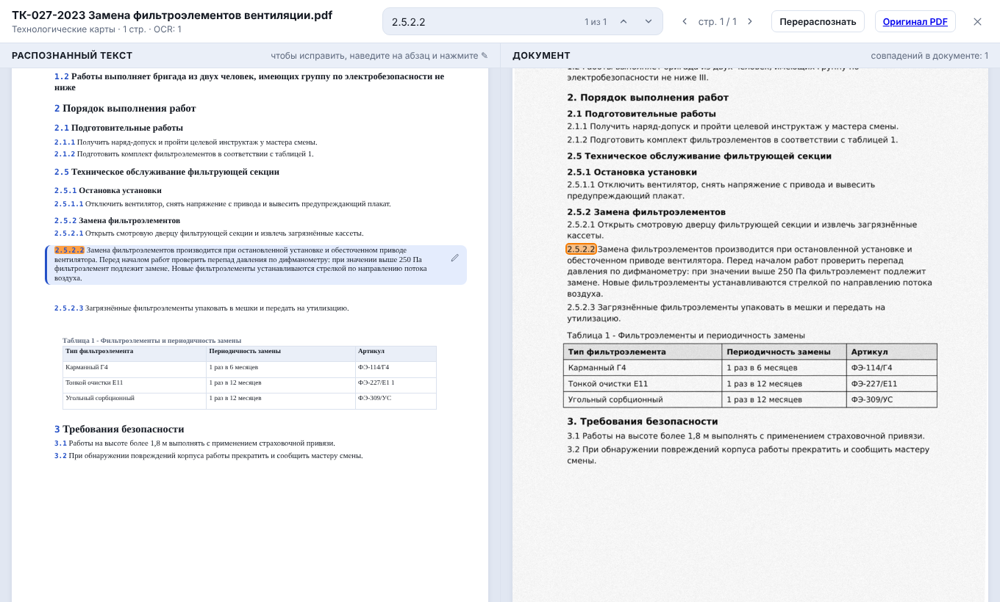
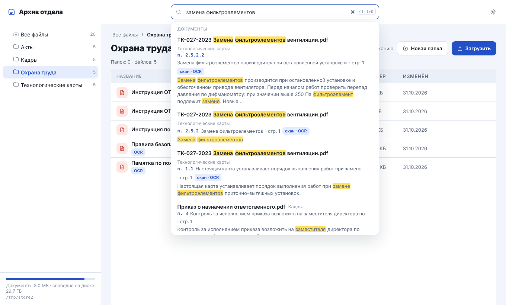
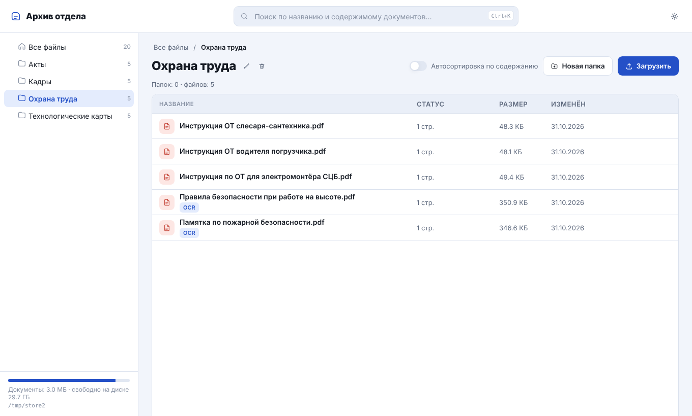
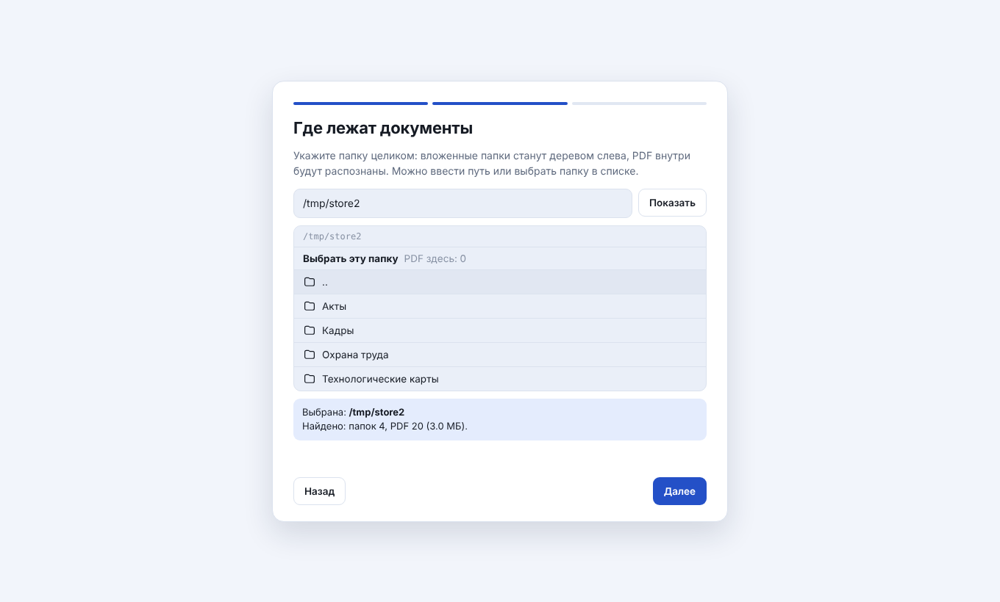

<div align="center">

# Handbook

**Поиск по тексту внутри PDF и Word, а не по названиям файлов.**
Подключи любую папку с документами: они разберутся сами, и нужный пункт договора, регламента или ТК находится по одной фразе.


-4B8BBE)


[Зачем](#зачем) · [Возможности](#возможности) · [Как это выглядит](#как-это-выглядит) · [Быстрый старт](#быстрый-старт) · [Под капотом](#под-капотом) · [Ограничения](#ограничения)



</div>

## Зачем

В каждой команде есть папка с сотнями PDF: инструкции, акты, регламенты, технологические карты. Проводник ищет только по имени файла, сканы не читает вообще, и чтобы найти «п. 2.5.2.2», приходится открывать документы по одному.

Handbook подключается к такой папке и ищет по содержимому:

- запрос `2.5.2.2` открывает документ сразу на нужном пункте и подсвечивает его в оригинале;
- «замена фильтроэлементов» находит «заменить фильтроэлемент», в том числе внутри таблиц;
- ничего переносить не надо: файлы лежат где лежали, программа читает папку как есть.

## Возможности

| | |
|---|---|
| **Подключается к готовой папке** | Выбираешь папку при первом запуске, дерево берётся с диска, файлы не копируются и не меняются. Что поменялось снаружи, подхватывается само. Сетевая папка (`\\сервер\общая`) тоже подойдёт: если связь оборвалась, уже распознанное не пропадает. |
| **PDF и Word** | `.docx` попадают в тот же поиск и тот же просмотр, что и PDF: пункты, таблицы, страницы. |
| **Ищет с учётом морфологии** | Русские словоформы (snowball) поверх SQLite FTS5: по тексту, таблицам, названиям файлов и папок. |
| **Просмотр «слева текст, справа оригинал»** | Слева распознанное в виде страниц того же размера, справа оригинал, прокручиваются вместе. Таблицы стоят в своих рамках, в том числе многостраничные. |
| **Правка прямо в просмотре** | Поправил абзац или ячейку, и поиск сразу знает новый текст. У таблиц есть редактор: строки, столбцы, склейка, разбиение, вставка из Excel. |
| **Скачать в Word, копировать без разрывов** | Распознанный текст с таблицами и правками выгружается в `.docx`. Выделение слева через несколько страниц копируется сплошным текстом, таблицы вставляются таблицами. |
| **Опечатки и раскладка** | Слово, которого нет в индексе, исправляется само: «фильтроэлемнт» находится как «фильтроэлемент», запрос «juhf;ltybt rhfz rhjdkb» как «ограждение края кровли». Над выдачей написано, что исправлено, и есть ссылка «Искать как написано». Правильные запросы не затрагиваются. |
| **Сроки действия и пересмотр** | У файла можно указать «действует до», «пересмотр до» и редакцию. За 30 дней до срока файл желтеет, после срока краснеет; пометки видны в списке, в выдаче и в шапке просмотра, а значок «сроки» над списком собирает такие файлы вместе. |
| **Новая редакция** | Кнопка у файла загружает новую редакцию в ту же папку. Прежний файл не удаляется и не меняется, а помечается заменённым и пропадает из поиска (его можно вернуть переключателем в поиске или кнопкой «Вернуть как актуальный»). Все редакции документа собраны в окне «Редакции»: кнопка в просмотре и значок «редакций: N» в списке, любую можно открыть. |
| **Проверка дублей** | При загрузке файл сравнивается по содержимому с уже загруженными: если такой есть, программа предлагает показать его, загрузить всё равно или отказаться. |
| **История поиска** | Недавние запросы под строкой поиска, лежат только в этом браузере. |
| **Перераспознать** | Кнопка в просмотре, в меню файла и в меню папки (на всё содержимое), плюс одна общая на всё хранилище. Ручные правки при этом сбрасываются. |
| **Сортирует сам** | Файл, брошенный во «Входящие», уходит в подходящую папку по содержанию; если не уверен, остаётся с пометкой «проверить». По умолчанию выключено. |
| **Файловые операции** | Создать, переименовать, перенести, удалить (в корзину внутри хранилища), загрузить. Всё делается прямо на диске. |

**Сканы.** Распознавания сканов в программе нет: Tesseract подключается только если он стоит в системе (см. ниже). Без него страница-скан показывается картинкой, в поиск не попадает, в шапке просмотра написано «скан без распознавания». Найти такой файл можно по названию.

## Как это выглядит

| Поиск по содержимому | Хранилище |
|---|---|
|  |  |

Первый запуск: мастер подключает папку и настраивает программу под тебя.



## Быстрый старт

Нужен Python 3.10 или новее.

```bash
git clone https://github.com/flagg11/handbook.git
cd handbook
python -m venv .venv
.venv\Scripts\activate          # Linux и macOS: source .venv/bin/activate
pip install -r requirements.txt
python app.py
```

Открыть http://127.0.0.1:5000, выбрать папку с PDF и Word. Если папки под рукой нет, в мастере есть «Учебный набор»: 61 готовый документ в готовом дереве (разбор занимает несколько минут).

**Tesseract (необязательно).** Если хочется читать сканы, поставь [Tesseract](https://github.com/UB-Mannheim/tesseract/wiki) с русским языком (при установке отметь Russian в Additional language data). Лежит не в `C:\Program Files\Tesseract-OCR`, тогда укажи путь: `set TESSERACT_CMD=C:\путь\к\tesseract.exe`. Без него всё остальное работает как обычно.

**Работа в локальной сети.** По умолчанию программа слушает только `127.0.0.1`, то есть сам компьютер. Для сети нужен пароль (без него сервер не запустится):

```bash
set HANDBOOK_HOST=0.0.0.0
set HANDBOOK_PASSWORD=придумай-длинный-пароль
set HANDBOOK_ALLOWED_HOSTS=имя-сервера,10.0.0.5
python app.py
```

Вход по HTTP Basic: логин `handbook` (меняется через `HANDBOOK_USER`), пароль общий. Он идёт по сети открытым текстом, поэтому в сети лучше ставить программу за HTTPS-прокси (сама остаётся на `127.0.0.1`), а порт на firewall открыть только рабочим местам. В интернет такой сервер выставлять нельзя. Выбор папки и отключение хранилища работают только на самом сервере. Подробно про риски и меры: `docs/security.docx`.

**Сброс.** Чтобы начать с нуля и снова увидеть мастер: `python tools/reset_data.py`. Скрипт ничего не удаляет, а переносит данные в `_backup_...`.

## Под капотом

Цепочка такая: страницы PDF (для `.docx` сначала собственная конвертация в PDF), текстовый слой или OCR, очистка от штампов и колонтитулов, нарезка на пункты и таблицы, индекс. Парсер запоминает не только текст, но и геометрию: страницу и рамку таблицы, строки фрагмента на каждой странице, кегль и межстрочный. Поэтому левая панель собирается из тех же страниц, что и правая, а не подгоняется потом.

```
app.py           Flask: страница и API, проверки доступа
storage.py       подключаемая папка: настройки, чтение диска, файловые операции
docparse.py      разбор PDF: текст, таблицы, OCR, геометрия, нарезка на пункты
docxconv.py      Word -> PDF (python-docx и PyMuPDF, Word не нужен)
exportdoc.py     выгрузка распознанного текста в Word
searchindex.py   SQLite: папки, документы, фрагменты, FTS5-поиск
classify.py      автосортировка по содержанию
static/, templates/   интерфейс
docs/            скриншоты и пояснительная записка по безопасности
samples/, demo_upload/, tools/   учебные документы, эталоны, скрипты проверки
```

Проверка скриптами из `tools/` на учебных документах: автосортировка положила 71 из 73 файлов точно в нужную папку (два ушли в общий раздел с пометкой, неверных нет); с установленным Tesseract структура таблиц на сканах верна в 25 случаях из 25, ячейки совпадают точно в 302 из 317. Поиск на тех же документах: из 30 запросов словами документа (в том числе в другой форме, номера пунктов, ячейки таблиц) нужный документ стоит первым в 30; своими словами из 4 запросов первым один, в первых трёх три, то есть по смыслу программа не ищет. При росте набора до 610 документов ответ в среднем 10 мс. Документы учебные, на настоящих цифры будут ниже.

```bash
python tools/eval_classify.py   # автосортировка
python tools/eval_blind.py      # автосортировка на втором наборе
python tools/eval_search.py     # поиск: 30 запросов словами документа и 4 своими словами
python tools/eval_scale.py      # время ответа при росте набора (61, 305, 610 документов)
python tools/eval_ocr.py -v     # таблицы и слова сканов против эталона (нужен Tesseract)
```

## Ограничения

- Только PDF и Word (`.docx`). Картинки внутри Word-файлов не переносятся, а вид страниц строит сама программа, поэтому он может отличаться от Word.
- Старый формат `.doc` не читается: такие файлы пропускаются, внизу слева пишется сколько их, при загрузке будет понятная ошибка. Лечится пересохранением как `.docx`.
- Без Tesseract сканы в поиск не попадают; с ним плохие сканы, фото страниц и таблицы без линий читаются заметно хуже.
- Схемы и чертежи не распознаются, показываются картинкой.
- Один общий пароль на всех, ролей и журнала действий нет. Права на сетевую папку к пользователям программы не применяются: видно всё, что видит учётная запись, под которой она запущена.
- Рассчитана на небольшую локальную сеть: встроенный сервер Flask, без ограничения числа запросов.

## Лицензия

MIT, см. файл [LICENSE](LICENSE).
